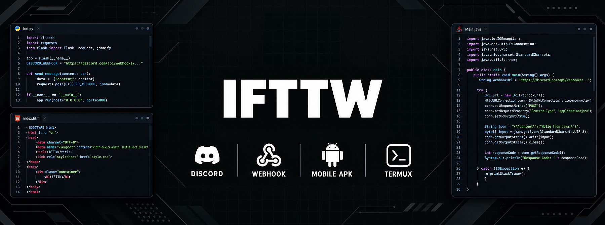
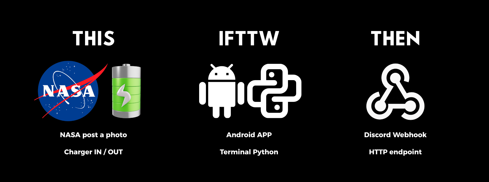

<div align="center">



### If This Then Webhook

**Turn NASA space photos and your phone's charger events into Discord messages.**


</div>

---

## Table of Contents

- [Overview](#overview)
- [Download](#download)
- [Built-in Applets](#built-in-applets)
- [Features](#features)
- [Getting Started](#getting-started)
- [Ingredients](#ingredients)
- [Background Behavior on Android](#background-behavior-on-android)
- [Battery Usage](#battery-usage)
- [Run on Termux](#run-on-termux)
- [Build the APK](#build-the-apk)
- [Project Structure](#project-structure)
- [Privacy](#privacy)
- [Disclaimer](#disclaimer)

## Overview

IFTTW is an Android app inspired by IFTTT, and it also runs on Termux. You choose a **trigger**, and IFTTW sends a
**web request** for you. By default, this is a Discord webhook with a message and image that you fully control.



## Download

[**Download the latest APK**](https://github.com/nebula-dotcom/ifttw-app/releases/latest/download/ifttw.apk), browse all versions on the [Releases page](https://github.com/nebula-dotcom/ifttw-app/releases), or [build it yourself](#build-the-apk).

The APK requires Android 7.0 or later on an `arm64-v8a` device.

## Built-in Applets

| Applet | Fires when | Trigger type |
| --- | --- | --- |
| **Image of the day by NASA** | NASA publishes a new Image of the Day | Polling (on demand via **Check now**) |
| **Astronomy picture of the day by NASA** | NASA publishes a new Astronomy Picture of the Day | Polling (on demand via **Check now**) |
| **Charger plugged** | The device is plugged into a charger | Real-time |
| **Charger unplugged** | The device is unplugged from a charger | Real-time |

## Features

- **Configurable action:** set the URL, method, headers, content type and a JSON body built from clickable ingredients.
- **Automation or Manual:** Automation sends the webhook by itself; Manual lets you post from **View activity**.
- **Real-time charger events** on Android through a system broadcast receiver. Termux falls back to polling.
- **Battery friendly:** no wake lock and no periodic timers while idle (see [Battery Usage](#battery-usage)).
- **Activity history** for every applet, with **Check now** for the NASA applets.
- **Lightweight:** a small local server built on the Python standard library (`certifi` is used only for HTTPS on Android). The UI is a single HTML file shown in a WebView.
- **Bundled fonts:** Nunito and Nunito Sans ship inside the app, so the UI looks the same offline.
- **Built-in error screen** that shows why the server failed to start instead of a blank page.

## Getting Started

**Requirements:** Android 7.0 or later (API 24) on an `arm64-v8a` device.

1. **Create a Discord webhook.** In your server, go to **Server Settings > Integrations > Webhooks > New Webhook**, then copy the webhook URL.
2. **Get the app.** [Download the APK](#download), [build it yourself](#build-the-apk), or [run it on Termux](#run-on-termux).
3. **Configure an applet.** Open an applet, tap **Configure**, paste the webhook URL and tap **Update action**. Then tap **Update** to apply the changes.
4. **Connect the applet.** Charger applets react in real time once connected. NASA applets run when you tap **Check now**.

## Ingredients

Ingredients are placeholders for the **URL**, **Additional Headers** and **Body** fields. IFTTW replaces them with real
values when it sends the webhook.

| Applet type | Ingredient | Meaning |
| --- | --- | --- |
| NASA | `{{ImageTitle}}` | Title of the image |
| NASA | `{{ImageSourceURL}}` | Direct image URL |
| NASA | `{{Explanation}}` | Description as plain text |
| NASA | `{{ExplanationHTML}}` | Description as HTML |
| NASA | `{{GalleryURL}}` | Link to the NASA page |
| NASA | `{{PublishedDate}}` | Publish date |
| Battery | `{{BatteryLevel}}` | Battery percentage |
| Battery | `{{OccurredAt}}` | Time the event happened |

### Mentioning yourself on Discord

The default body of the charger applets contains a Discord mention placeholder:

```json
{"content":"**Charger plugged** — {{BatteryLevel}}% <@tag_userID_discord>\n\n{{OccurredAt}}"}
```

To receive the ping:

1. In Discord, enable **User Settings > Advanced > Developer Mode**.
2. Right-click your profile and select **Copy User ID**.
3. In the applet's **Body**, replace `tag_userID_discord` with the copied ID.

> **Note:** Remove `<@tag_userID_discord>` if you do not want a mention.

## Background Behavior on Android

**Persistent notification**

- While the service is running, IFTTW shows a notification titled **Running · 4 Applets**. The number is how many applets are connected, and it updates when you connect or disconnect one.
- It has no body text, only an **Exit** button (like Termux). It uses the lowest importance level (**Minimized**): no sound, no status-bar icon, and it stays collapsed in the shade.
- Android requires a small icon on every notification, so `ifttw/res/notif_icon.png` is attached. It is a white logo on a transparent background (96×96 px). Android uses only its shape, and most phones do not draw it in the status bar at the Minimized level.
- The **Sent to webhook** notification uses the same level, and only one exists at a time: a new one replaces the previous one. After posting it, IFTTW refreshes **Running** so that it stays on top (Android sorts notifications by time).

**Closing the app**

- **Exit** is a full force close. It closes the screen, stops the service, removes the notification and ends every IFTTW process. It is implemented in `ServiceNotifier.java`. As a safety net, Java closes the app if Python has not done so within 6 seconds.
- Disconnecting the **last active applet** closes IFTTW exactly like **Exit**. Reconnecting an applet within about 1.5 seconds cancels the close.
- If you open the app while **no** applet is connected, it stays open only while the screen is in use and closes shortly after you leave.
- While all applets are disconnected, the app does **not** start at boot.

### Troubleshooting Notifications

While the app is running, open Termux and run:

```bash
curl http://127.0.0.1:5000/api/diag
```

The response shows whether notifications are enabled, the notification channel importance, and which notification IDs
are posted (**Running** uses ID `7002`). It also lists `running_actions`, the buttons attached to that notification.
Expect `running_actions` to be `["Exit"]` and `channel_importance` to be `1` (Minimized).

## Battery Usage

IFTTW is designed to run in the background without keeping the phone awake:

- **No wake lock.** The app never holds the CPU awake and does not request the `WAKE_LOCK` permission. Android wakes it only when something happens.
- **No polling for the charger.** The system delivers plug and unplug events to a broadcast receiver (`PlugReceiver.java`). Between events, the service sleeps and the local server does not wake on a timer. Polling (every 30 seconds) is only a fallback if the receiver fails to start.
- **NASA applets never run on their own.** They fetch data only when you tap **Check now**.
- **The screen process has no repeating work.** The WebView refreshes the activity text only while an applet detail page is visible.
- **Small data file.** Each applet keeps its latest 10 activity entries (the same number **View activity** shows), so `data.json` stays small.
- **Battery optimization exemption** is requested once so that Android does not kill the service. It does not increase drain; it only keeps the receiver alive.

## Run on Termux

```bash
pkg install python
python main.py
```

Then open <http://127.0.0.1:5000>.

For charger detection on Termux, install the `termux-api` package (`pkg install termux-api`) and the Termux:API app.

## Build the APK

GitHub Actions builds the APK automatically:

1. Push this repository to GitHub (branch `main`).
2. Open the **Actions** tab and select **Build**. The workflow runs on every push to `main` and can also be started manually. It is pinned to the `ubuntu-24.04` runner because the `ubuntu-latest` label moves to Ubuntu 26.04 on October 19, 2026, and Buildozer / python-for-android may not work on that image yet. It also uses the Node.js 24 releases of the official GitHub actions.
3. When the run succeeds, download the **IFTTW-APK** artifact at the bottom of the run page.

To build locally, run `buildozer -v android debug` on Linux with the dependencies listed in `.github/workflows/build.yml`.

The app version is the `version` line in `buildozer.spec` (currently **1.0**). Android refuses to install an APK over a build with a higher version code, so if the installation is rejected, uninstall the previous build first.

## Project Structure

Entries follow the order GitHub displays: directories first, then files, each in alphabetical order. Directories that
contain a single sub-directory are collapsed onto one line.

```text
IFTTW/
├── .github/workflows/
│   └── build.yml                   # GitHub Actions workflow that builds the APK
├── android/java/org/ifttw/
│   ├── BootReceiver.java           # Starts the service at boot (skipped if all applets are off)
│   ├── PlugReceiver.java           # Handles charger events and notification button actions
│   └── ServiceNotifier.java        # Persistent notification with an Exit button
├── assets/
│   ├── icon.png                    # Launcher icon
│   ├── icon_bg.png                 # Adaptive icon, background layer
│   ├── icon_fg.png                 # Adaptive icon, foreground layer
│   ├── ifttw_header.png            # README banner
│   ├── presplash.png               # Splash screen shown while the app loads
│   └── what-is-ifttw.png           # README overview illustration
├── ifttw/
│   ├── res/
│   │   └── notif_icon.png          # Small notification icon (white logo, transparent background)
│   ├── web/
│   │   ├── fonts/
│   │   │   ├── Nunito.woff         # Nunito (weights 800-900), Latin subset
│   │   │   ├── NunitoSans.woff     # Nunito Sans (weights 600-900), Latin subset
│   │   │   ├── OFL-Nunito.txt      # SIL Open Font License for Nunito
│   │   │   └── OFL-NunitoSans.txt  # SIL Open Font License for Nunito Sans
│   │   └── index.html              # App interface, rendered in a WebView
│   ├── __init__.py                 # Package marker
│   ├── app.py                      # Local HTTP server, applet logic and monitoring bot
│   ├── errpage.py                  # Fallback screen shown when the server fails to start
│   └── service.py                  # Android service entry point that runs app.py
├── p4a/
│   └── hook.py                     # python-for-android build hook that registers BootReceiver
├── .gitignore                      # Files excluded from version control
├── LICENSE.md                      # MIT License for the source code
├── README.md                       # Project documentation
├── buildozer.spec                  # Buildozer configuration for the APK build
└── main.py                         # Entry point for the APK and for Termux
```

Key points:

- `main.py` is the only top-level script. All application code lives in the `ifttw` package.
- `android/java/` is compiled into the APK through `android.add_src`, and `p4a/hook.py` is attached through `p4a.hook`. Both are set in `buildozer.spec`.
- `.github/`, `android/`, `assets/` and `p4a/` are build and documentation resources, so `source.exclude_dirs` in `buildozer.spec` keeps them out of the Python sources bundled into the APK.
- `assets/icon.png`, `assets/icon_bg.png`, `assets/icon_fg.png` and `assets/presplash.png` are referenced by `buildozer.spec`. `assets/ifttw_header.png` and `assets/what-is-ifttw.png` are used only by this README.
- `ifttw/res/notif_icon.png`, `ifttw/web/index.html` and `ifttw/web/fonts/*` are read at runtime, which is why `png`, `html`, `woff` and `txt` are listed in `source.include_exts`. The local server serves the fonts to the WebView through `/fonts/<name>.woff`.

### Files created at runtime

These files are not in the repository. On Android, they live in the app's private storage. On Termux, they are created next to `main.py`.

| File | Purpose |
| --- | --- |
| `data.json` | Applet settings and activity history. Git-ignored. |
| `data.json.bad` | Copy of an unreadable `data.json` (for example, after a power loss while saving). The app then starts with empty data. |
| `error.log` | Written by the fallback error screen when the server fails to start. |
| `all_off` | Android only. Exists while every applet is disconnected; `BootReceiver` checks it so the service does not start at boot. |
| `battery_asked` | Android only. Marks that the battery optimization prompt was already shown. |

## Privacy

Everything runs on your device. Applet settings, including webhook URLs, are stored locally in the app's private
storage (on Termux, in `data.json` next to `main.py`). The only network requests go to NASA's public feeds and to the
webhook URL you configure. The interface fonts are bundled with the app, so nothing is loaded from Google or any other
third party.

## Disclaimer

IFTTW is an independent hobby project. It is not affiliated with, endorsed by, or sponsored by IFTTT, NASA or Discord.
NASA imagery belongs to its respective owners.

The source code is licensed under the [MIT License](LICENSE.md).

The bundled **Nunito** and **Nunito Sans** fonts keep their own license, the SIL Open Font License 1.1 (copies are in
`ifttw/web/fonts/`). They are Latin subsets of the Google Fonts variable fonts, with the weight range trimmed to what the
interface uses.
